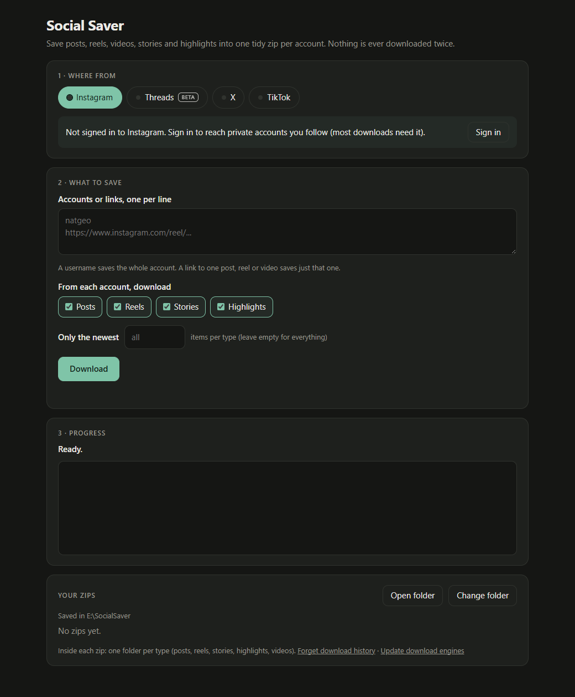

# Social Saver

One small app to save posts, reels, videos, stories and highlights from
Instagram, Threads, X and TikTok. Runs on Windows, on a Mac, as an Android app, and as a
private web app you can add to the home screen of an iPhone or Android phone. You pick the types you want. Everything lands
in one zip per account, sorted into folders. Run it again and it only adds what
is new.



Free, runs on your own PC, phone or private server, no account with us and no API keys. MIT licence.

## Open it

1. Download **[SocialSaver-windows.zip](https://github.com/juw12/social-saver/releases/latest/download/SocialSaver-windows.zip)** and unzip it.
2. Double-click `Start Social Saver.bat`.

The first run installs what it needs (Flask, pywebview, gallery-dl, yt-dlp). If the PC has no
Python yet, it installs Python 3.12 for you first (with winget, no admin needed).

**On a Mac:**

1. Download **[SocialSaver-mac.zip](https://github.com/juw12/social-saver/releases/latest/download/SocialSaver-mac.zip)** and unzip it.
2. Right-click `Start Social Saver.command` and choose **Open** (macOS asks once, because the file is not signed).

The first run makes a Python environment inside the folder and installs the same four things. The Mac needs
Python 3.10 or newer; without it the start file opens python.org's download page. Tried on a MacBook Pro (Intel,
macOS 15.7, Python 3.14): the first run installed everything, the window opened, a real file was downloaded by the
engine, and the 134 tests pass. The sign-in windows were tried on it without signing in: for Instagram, Threads, X and TikTok each opens on the site's own login page, and the app can read the cookies it watches for. A real sign-in with a password has not been done on a Mac yet.

## Use it

1. Pick the platform tab: Instagram, Threads, X or TikTok.
2. Type a username (or paste a profile link). One per line for several accounts.
   A link to a single post, reel or video saves just that one item.
3. Tick the types you want. Optional: fill in "Only the newest" to take just the latest few.
4. Press **Download**. The log shows progress.

**Only some photos of one post?** Paste a single post link and press **Choose items...**.
You get a grid of thumbnails; untick what you don't want and press **Save selected**.

## Use it on your phone (Android or iPhone)

Five ways. Pick one. The ones that run on your own phone or PC have **no limits at all**;
every free hosting service has some.

| Way | Phones | Needs a PC? | Limits of the free hosting |
|-----|--------|-------------|----------------------------|
| [Android app](#android-app-no-pc) | Android 10+ | no | none (runs on the phone) |
| [Web downloader on your PC](#web-downloader-on-your-own-pc-no-limits) | iPhone and Android | yes, switched on | none (runs on your PC) |
| [Phone + PC](#phone--pc-same-wi-fi) | iPhone and Android | yes, same Wi-Fi | none (runs on your PC) |
| [Web downloader on Vercel](#web-downloader-free-no-card) | iPhone, Android, any browser | no | free, no card, about 10 GB of downloads a month |
| [Full web app](#full-web-app-render) | iPhone and Android | no | Render may ask for a card; sleeps after 15 minutes |

**iPhone and Android home screen:** open **https://juw12.github.io/social-saver/** in Safari (Share → *Add to Home Screen*)
or Chrome (menu → *Add to Home screen*). It is a small page that remembers the address of your own copy (your Vercel
address or your PC) and opens it; the address stays in that browser. There is no shared Social Saver that everyone uses.

### Web downloader (free, no card)

Like the downloader sites: type a username (or paste a post link), see the posts as
pictures, tick what you want and download it - one file, or a zip of everything you
ticked. It runs on your own free [Vercel](https://vercel.com) address (Hobby plan, sign in
with GitHub, **no credit card**). One-time setup, about 3 minutes:

1. Press **[Deploy to Vercel](https://vercel.com/new/clone?repository-url=https%3A%2F%2Fgithub.com%2Fjuw12%2Fsocial-saver&project-name=social-saver&repository-name=social-saver-web&env=SOCIAL_SAVER_PASSWORD&envDescription=A%20password%20only%20you%20know%20(the%20page%20asks%20for%20it))**
   and sign in with GitHub. (Own this repo already? Use *Add New > Project > Import*
   on it instead; then every update here redeploys by itself.)
2. Vercel asks for **SOCIAL_SAVER_PASSWORD**: type a password only you know, so nobody
   else can use your copy. Press **Deploy** and wait about a minute.
3. Open your address (like `https://social-saver-xxxx.vercel.app`) on the phone, type the
   password, then Safari Share > **Add to Home Screen** to keep it as an app.

How to use it: pick **TikTok**, **Instagram**, **Threads** or **X**, type the username or paste
the link of the account (a link picks the right platform by itself), **Search**.
Thumbnails appear as they are found (24 at a time, **Load more** for older posts). Tap
pictures to tick them and press **Download**; the arrow under a picture saves just that
one, **View** shows it big. On iPhone the files land in Files > Downloads (open a photo
or video there and Share > Save to Photos).

Honest limits (tested from a cloud server, the same kind Vercel uses):

- **TikTok works without signing in** (public accounts and single videos).
- **Instagram and X do not show posts to a server that is not signed in.** Open
  *Sign-in cookies* on the page and paste your cookies once: on a computer, sign in to the
  site, use the free **Cookie-Editor** browser extension > Export > JSON, and paste it (or
  load the exported file). They stay in that browser only and go along with each search;
  the server keeps nothing.
- **Threads (beta)** is tried without signing in; if it finds nothing, paste your Threads
  cookies the same way. From a cloud server it listed public posts and downloaded a
  file without cookies (checked in CI).
- Download links expire after a few hours; search again for fresh ones. One search can run
  up to 5 minutes (Vercel's free limit), so very large accounts load page by page.
- **Vercel's free plan never charges, but it is not unlimited** (Hobby plan limits, read in
  November 2026): every file you download passes through Vercel and counts against
  10 GB of "Fast Origin Transfer" a month, so you get **about 10 GB of downloads a month**;
  it is for personal, non-commercial use only. Over the limit Vercel pauses the site until
  the limits reset (up to 30 days). It cannot bill you: there is no card on the account.
  We found no hosting service that is free, needs no card and has no cap. For no limits,
  use the [Android app](#android-app-no-pc) or run this same page
  [on your own PC](#web-downloader-on-your-own-pc-no-limits).

### Web downloader on your own PC (no limits)

The same page as above, but your own PC does the work instead of Vercel: no account, no
monthly cap, nothing that can ever cost money. Instagram and X also see a home connection
instead of a cloud server, which they block less.

1. On the PC, download **[SocialSaver-windows.zip](https://github.com/juw12/social-saver/releases/latest/download/SocialSaver-windows.zip)**,
   unzip it and double-click `Start Web Downloader.bat`. The first run installs what it needs.
2. The window shows an address (like `http://192.168.1.23:8080/`), a QR code and a
   password. On the phone, on the same Wi-Fi, open the address or scan the QR code and
   type the password once.
3. Keep it as an app: iPhone Safari Share > **Add to Home Screen**; Android Chrome
   menu > **Add to Home screen**.

- The PC must be on with that window open. Close the window to stop.
- The first time, Windows may ask whether Python may use the network: allow
  **Private networks**.
- The password is made once and kept on the PC (`%LOCALAPPDATA%\SocialSaver\settings.json`,
  `web_password`). To choose your own, set `SOCIAL_SAVER_PASSWORD` before starting.
- **Away from home:** install [Tailscale](https://tailscale.com) (free Personal plan, no
  card) on the PC and on the phone, sign in to both with the same account, and open
  `http://<the PC's Tailscale address>:8080/` from anywhere. It is a private link between
  your own devices; nothing is open to the internet. (Not tested by us yet.)
- Do not run it on an office network: company proxies block Instagram and TikTok.
- Same as on Vercel: TikTok works without signing in, Instagram and X want your cookies
  pasted once, Threads (beta) is tried without signing in.

### Android app (no PC)

1. On the phone, download **[SocialSaver-android.apk](https://github.com/juw12/social-saver/releases/latest/download/SocialSaver-android.apk)**.
2. Open it. Android asks to allow installs from this source (Chrome or Files): allow it,
   then tap **Install**. It is not from the Play Store, so Play Protect may warn once.
3. Open **Social Saver**. It is the same screen as on the PC and does the downloading on
   the phone itself (Python and the download engines are inside the app).

- **Share to the app:** in Instagram, Threads, X or TikTok tap Share > **Social Saver**.
  The link is filled in for you.
- **Sign in:** the Sign in button opens the platform's real login page inside the app;
  only the session cookie is kept, on the phone. **Import cookies file** also works.
- Zips go to **Download/SocialSaver** on the phone (tap a zip in "Your zips").
- Updates: download the newer APK and install it over the old one; sign-ins stay.

### Full web app (Render)

The complete app (whole-account zips, history) on a [Render](https://render.com) server.
Render may ask for a card even for the free plan; if it does, use one of the
web downloaders above instead. One-time setup, about 5 minutes:

1. Press **[Deploy to Render](https://render.com/deploy?repo=https://github.com/juw12/social-saver)**
   and sign in to Render with your GitHub account.
2. Render asks for **SOCIAL_SAVER_PASSWORD**: type a password only you know. Press
   **Deploy** and wait until it says *Live* (first build takes a few minutes).
3. Open your address (like `https://social-saver-xxxx.onrender.com`) on the phone and
   type the password.
4. Keep it as an app: iPhone Safari Share > **Add to Home Screen**; Android Chrome
   menu > **Add to Home screen** (on Android you can then also share posts to it).

- Tap a zip in "Your zips" to save it to the phone (iPhone: Files app > Downloads).
- Sign in with **Import cookies file** (export cookies on any browser, see
  [Sign in](#sign-in-for-private-accounts-you-follow)). The browser on your phone keeps
  them and sends them again whenever the server restarts.
- Free plan limits: the server sleeps after 15 minutes without use, so the first open
  takes about a minute; files on the server are wiped when it restarts, so save your
  zips to the phone right away.
- Instagram often blocks cloud servers. If Instagram fails there, use the Android app
  or Phone + PC for Instagram. X and TikTok usually work.

### Phone + PC (same Wi-Fi)

In the app on the PC, turn on **Use on your phone** (bottom card) and scan the QR code
with the phone camera. The phone shows the same screen; the PC does the downloading.
Tap a zip in "Your zips" to keep a copy on the phone.

- Keep it as an app: iPhone Safari Share > **Add to Home Screen**; Android Chrome
  menu > **Add to Home screen**.
- The first time, Windows may ask whether Python may use the network: allow
  **Private networks**.
- Only phones that scanned the QR code get in (the link carries a private key).
  **New key** locks out every phone that scanned before.
- Sign in on the PC. On the phone you can also use **Import cookies file**.
- **iPhone share button (optional):** in the Shortcuts app make a shortcut that
  receives URLs from the Share Sheet, then *URL Encode* the input and *Open URLs*
  `<your Social Saver address>&url=<encoded input>` (use `?url=` if the address has no
  `?`). Sharing a post to it opens Social Saver with the link already filled in. This
  works for the web app too.

**Android with Termux (older way):** install [Termux](https://f-droid.org/packages/com.termux/)
(from F-Droid or GitHub, not the old Play Store build) and run:

```
curl -fsSL https://raw.githubusercontent.com/juw12/social-saver/main/mobile/termux-setup.sh | bash
```

Then **share** a post or profile **to Termux** and it is saved to `Download/SocialSaver`.

**Why no iPhone app?** Apple does not allow downloader apps in the App Store and iOS
cannot run Python apps from outside it, so on an iPhone use the web app.

## Where the files go

Default folder is `E:\SocialSaver` (change it in the app).

```
instagram_someuser.zip
    posts/
    reels/
    stories/
    highlights/<highlight name>/
tiktok_someuser.zip
    videos/
    posts/
    stories/
```

| Platform  | Types you can tick                  |
|-----------|-------------------------------------|
| Instagram | posts, reels, stories, highlights   |
| Threads   | posts, videos (beta)                |
| X         | posts (photos), videos              |
| TikTok    | videos, posts (photos), stories     |

## Sign in (for private accounts you follow)

Press **Sign in** on a tab. The real login page of that platform opens in its
own window. You type your password there, on their page. The app never sees
it. It only keeps the session cookie, on this PC, in
`%LOCALAPPDATA%\SocialSaver\cookies\`.

- Private accounts work only if your account already follows them.
- Stories and highlights on Instagram always need sign-in. X needs sign-in for
  almost everything.
- "Continue with Google" buttons may not work in the sign-in window. Use
  username and password, or the QR code.
- **Sign out** deletes the cookie file.

**Import cookies file** (next to Sign in) is the other way in: if the sign-in window
won't work (Google login, a security check), sign in with your normal browser, export
the cookies with an extension such as "Get cookies.txt LOCALLY" or "Cookie-Editor"
(cookies.txt or JSON), and pick that file. Only that platform's cookies are kept, and a
file without the login cookie is refused, so a bad export never breaks a working sign-in.

## No duplicates

The app remembers every item it has saved (`history.sqlite3`) and also checks
what is already inside the zip. A second run only adds new items.
"Forget download history" clears the memory; the zip check still stops
duplicates.

## Good to know

- **Office network:** the company proxy blocks Instagram, TikTok and Threads.
  Use the app on home Wi-Fi or a phone hotspot for those. X works at the office.
- **Threads is beta:** it reads the profile page, then loads older posts the same
  way the Threads website does when you scroll (it finds the current "load more"
  query in the page itself, because Meta changes it often). If that fails, you still
  get the newest posts and the log says so. Advanced: put `"threads_doc_id": "<id>"`
  in `%LOCALAPPDATA%\SocialSaver\settings.json` to pin the query id.
- **If a platform stops working:** press "Update download engines". Platforms change
  their sites often and the download engines get fixes every few days.
- Download slowly and for yourself only. Mass downloading can get an account
  rate-limited or restricted, and re-posting other people's content is not OK.

## For developers

```
python -m pytest -q      # no network needed; CI runs them on Windows + Linux
python app.py            # run with a console
python app.py --serve    # no window: open the screen in a browser (add --host 0.0.0.0 for phones)
python app.py --save <link or text with a link>   # save now and exit (Android "Share")
python app.py --self-test <file url>   # one real engine download, prints SELFTEST OK
SOCIAL_SAVER_PASSWORD=... python app.py --serve --host 0.0.0.0   # web app mode (password login)
```

- `app.py` - window, local API, job runner
- `saver/core.py` - link parsing, engine config, zip sorting, duplicate check
- `saver/threads.py` - Threads reader (beta)
- `saver/phone.py` - phone mode: key, QR code, the Wi-Fi server
- `saver/engine.py` - runs gallery-dl inside the app process (Android has no subprocesses)
- `android/` - Android app (Kotlin WebView + Python via Chaquopy); `android/sync.sh` copies
  the Python app in, CI builds the APK and starts it on an emulator
- `Dockerfile`, `render.yaml` - the web app (Render blueprint)
- `saver/webdl.py`, `web/index.html`, `api/index.py`, `vercel.json` - the web downloader (Vercel);
  run it locally with `python -m saver.webdl` (add `--phone` to let phones on the Wi-Fi in;
  `Start Web Downloader.bat` does that)
- `mobile/termux-setup.sh` - Android setup (Termux)
- `ui.html` - the screen
- `tests/` - uses a fake engine, so tests never touch the real sites

Set `SOCIAL_SAVER_HOME` to move the data folder (cookies, history, settings) and
`SOCIAL_SAVER_OUTPUT_DIR` to change the default zip folder.

## Status

Early version. The app, zip sorting and duplicate check are covered by tests with a fake
engine; CI also runs a real engine download in the web app container and in the Android
app on an emulator (not yet on a real phone). A real signed-in download has not been confirmed yet on every platform; please
open an issue if one breaks.
